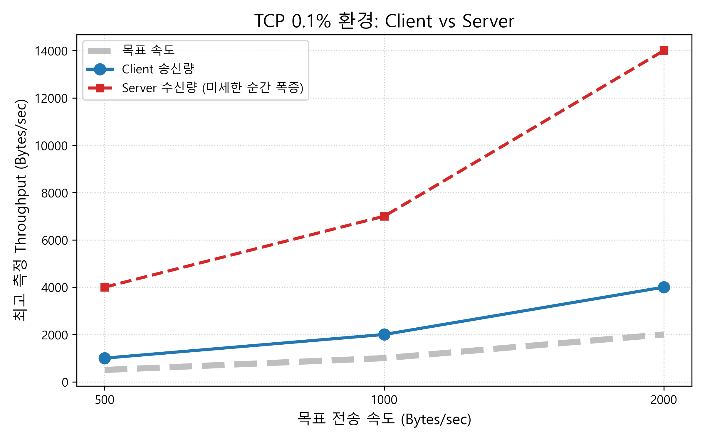
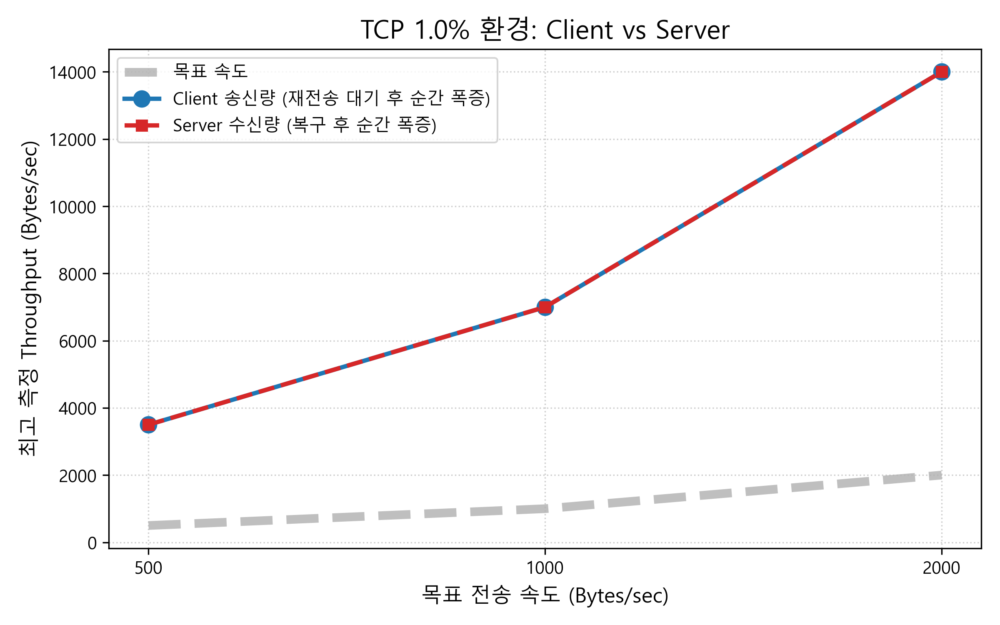
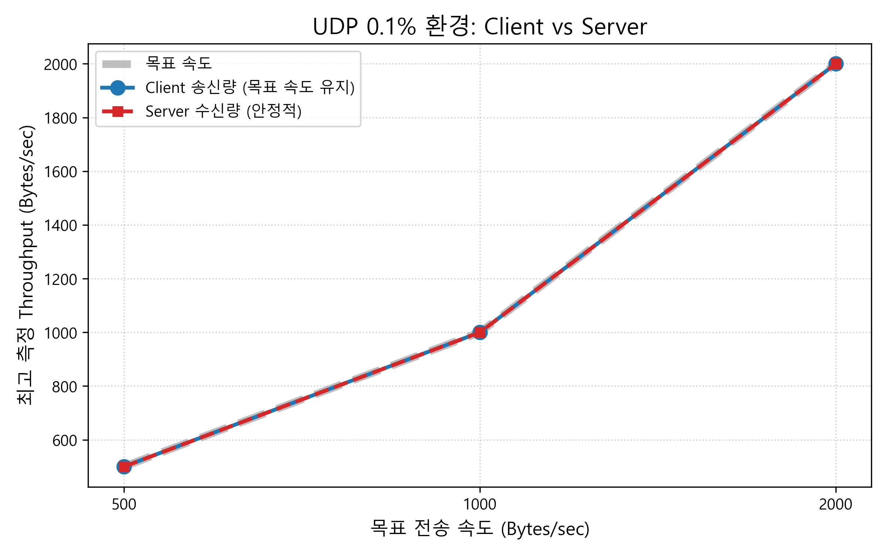
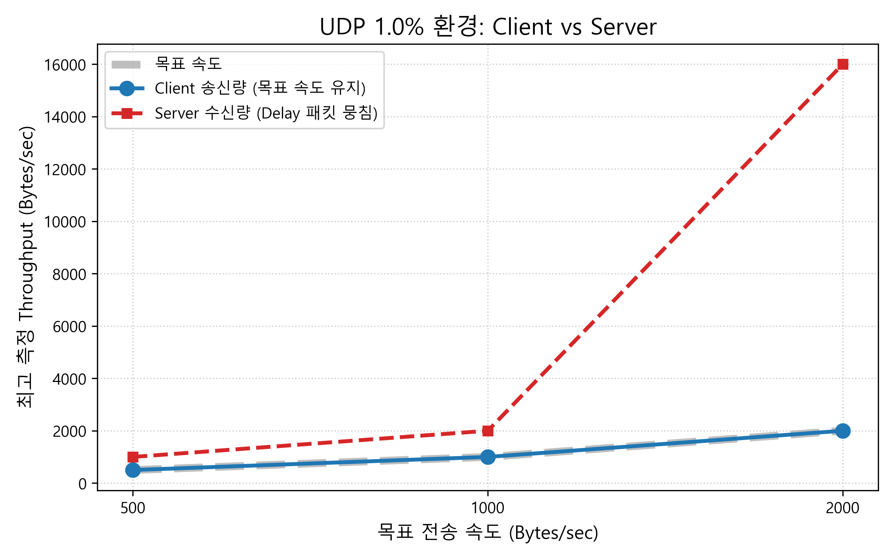

# TCP 및 UDP 에코 서버/클라이언트 통신 분석 보고서

## 목차

- [1. TCP 및 UDP 기반 프로그램 기능 검증 및 환경](#1-tcp-및-udp-기반-프로그램-기능-검증-및-환경)
  - [1.1 검증 환경](#11-검증-환경)
  - [1.2 기능 검증 과정 및 결과](#12-기능-검증-과정-및-결과)
- [2. UDP 프로그램 작성 시 TCP 기반 프로그램과의 차이점](#2-udp-프로그램-작성-시-tcp-기반-프로그램과의-차이점)
  - [2.1 구현(코드) 상의 차이점](#21-구현코드-상의-차이점)
- [3. 전송 속도 및 패킷 손실률 변화에 따른 Throughput 측정 결과](#3-전송-속도-및-패킷-손실률-변화에-따른-throughput-측정-결과)
  - [3.1 에코 모드 - 패킷 손실률 0.1% 환경 측정 결과](#31-에코-모드---패킷-손실률-01-환경-측정-결과)
  - [3.2 에코 모드 - 패킷 손실률 1.0% 환경 측정 결과](#32-에코-모드---패킷-손실률-10-환경-측정-결과)
  - [3.3 단방향 모드 - 패킷 손실률 0.1% 환경 측정 결과](#33-단방향-모드---패킷-손실률-01-환경-측정-결과)
  - [3.4 단방향 모드 - 패킷 손실률 1.0% 환경 측정 결과](#34-단방향-모드---패킷-손실률-10-환경-측정-결과)
  - [3.5 TCP vs UDP Throughput 비교 그래프](#35-tcp-vs-udp-throughput-비교-그래프)
- [4. 결과 분석 (TCP와 UDP의 차이 및 모드별 특성)](#4-결과-분석-tcp와-udp의-차이-및-모드별-특성)
  - [4.1 에코 모드(양방향) 환경에서의 RTT 지연 및 순간 폭증 현상 분석](#41-에코-모드양방향-환경에서의-rtt-지연-및-순간-폭증-현상-분석)
  - [4.2 단방향 모드(수신 후 삭제)에서의 누적 평균 처리량 분석](#42-단방향-모드수신-후-삭제에서의-누적-평균-처리량-분석)
- [5. 결론 및 요약](#5-결론-및-요약)

---

## 1. TCP 및 UDP 기반 프로그램 기능 검증 및 환경

### 1.1 검증 환경

- **운영체제(OS)**: Windows 11 (WSL2 - Ubuntu 24.04)
- **컴파일러**: GCC 13.3.0
- **네트워크 제어 도구**: Linux `tc` (NetEM)
  - 네트워크 장애 환경 구축 용도
  - Delay 100ms, Loss 0.1% ~ 1.0% 설정
- **포트번호 및 버퍼 사이즈**
  - **Port**: 2022 
  - **Buffer Size**: 2017 bytte

---

### 1.2 기능 검증 과정 및 결과

본 프로그램은 한 번에 하나의 클라이언트와 통신하는 서버/클라이언트 구조로 구현하였다.

과제 요구사항을 모두 충족하기 위해 프로그램 내에 **'1. 에코 모드(슬라이드 2)'** 와 **'2. 단방향 측정 모드(슬라이드 3)'** 를 선택할 수 있도록 구현하여, 각각의 환경에서 발생하는 네트워크 동작의 차이를 비교하였다.

- **기본 통신 및 데이터 전송률(Throughput) 검증**
  - 클라이언트에서 `sleep(1)` 함수를 사용하여 초당 500, 1000, 2000 Bytes의 데이터를 전송하도록 로직을 구현하였다.
  - 네트워크 지연의 누적 효과를 명확히 관찰하기 위해 **1초 단위의 실시간 송수신량**과 **전체 실행 시간 기반의 누적 평균 처리량**을 동시에 계산하여 출력하도록 하였다.

- **실시간 시각화 로직 추가**
  - 터미널에 출력되는 수치만으로는 파악하기 어려운 네트워크의 정체와 흐름 변화를 직관적으로 관찰하기 위해, 터미널 출력 시 **500바이트 수당 1개의 막대그래프(`■`)** 가 출력되도록 시각화하는 로직을 추가하여 데이터의 몰림 현상을 검증하였다.

- **네트워크 장애 환경 검증**
  - `tc` 명령어로 패킷 손실률을 0.1%와 1.0%로 설정하여 가상의 악화된 네트워크 환경에서 각 프로토콜이 어떻게 다르게 동작하는지 비교하여 검증하였다.

---

## 2. UDP 프로그램 작성 시 TCP 기반 프로그램과의 차이점

### 2.1 구현(코드) 상의 차이점

- **소켓 타입 설정**
  - TCP는 신뢰성 있는 스트림을 위해 `SOCK_STREAM`을, UDP는 데이터그램을 위해 `SOCK_DGRAM`을 사용한다.

- **연결 과정**
  - TCP는 클라이언트의 `connect()`와 서버의 `listen()`, `accept()`를 통한 3-Way Handshaking이 필수적이다.
  - 반면 UDP는 연결 과정 없이 서버가 바로 수신 대기하며, 클라이언트도 즉시 데이터를 전송한다.

- **데이터 송수신 함수**
  - TCP는 연결이 유지된 상태에서 `send()`, `recv()`를 사용하지만, 비연결형인 UDP는 송신 시마다 목적지 주소를 지정하는 `sendto()`와 송신자 정보를 함께 얻는 `recvfrom()`을 사용한다.

---

## 3. 전송 속도 및 패킷 손실률 변화에 따른 Throughput 측정 결과

본 장에서는 TCP와 UDP 프로토콜을 **에코 모드**와 **단방향 측정 모드**에서 각각 실행하고, 네트워크 지연(RTT 100ms) 및 패킷 손실률(0.1%, 1.0%) 환경에 따른 **실시간/누적 평균 Throughput의 변화**를 통합하여 비교 분석한다.

### 3.1 에코 모드 - 패킷 손실률 0.1% 환경 측정 결과

손실률 0.1% 환경에서는 에코 모드임에도 불구하고 두 프로토콜 모두 목표 전송 속도를 전반적으로 잘 달성하였다.

| 프로토콜 | 목표 속도 | 측정 결과(서버/클라이언트) |
| :---: | :---: | :---: |
| TCP | 500 B/s |  |
| TCP | 1000 B/s |  |
| TCP | 2000 B/s |  |
| UDP | 500 B/s |  |
| UDP | 1000 B/s |  |
| UDP | 2000 B/s |  |

---

### 3.2 에코 모드 - 패킷 손실률 1.0% 환경 측정 결과

네트워크 손실률을 1.0%로 증가시켰을 때, 에코 통신 구조에 따른 대기 현상으로 인해 누적 평균이 크게 깎이고 실시간 수치가 폭증 하는 현상이 뚜렷하게 관찰되었다.

| 프로토콜 | 목표 속도 | 측정 결과(서버/클라이언트) |
| :---: | :---: | :---: |
| TCP | 500 B/s |  |
| TCP | 1000 B/s |  |
| TCP | 2000 B/s |  |
| UDP | 500 B/s |  |
| UDP | 1000 B/s |  |
| UDP | 2000 B/s |  |
---

### 3.3 단방향 모드 - 패킷 손실률 0.1% 환경 측정 결과

서버가 응답을 반환하지 않고 즉시 삭제하는 모드에서의 순수 송수신 결과이다. 낮은 손실률(0.1%)은 목표 전송률 달성에 큰 영향을 미치지 않았다.

| 프로토콜 | 목표 속도 | 측정 결과(서버/클라이언트) |
| :---: | :---: | :---: |
| TCP | 500 B/s |  |
| TCP | 1000 B/s |  |
| TCP | 2000 B/s |  |
| UDP | 500 B/s |  |
| UDP | 1000 B/s |  |
| UDP | 2000 B/s |  |

---

### 3.4 단방향 모드 - 패킷 손실률 1.0% 환경 측정 결과

에코 대기가 없는 상태에서 1.0%의 패킷 손실이 발생했을 때, TCP의 재전송 지연으로 인한 누적 평균 하락과 UDP의 정직한 손실 반영이 대조적으로 관찰되었다.

| 프로토콜 | 목표 속도 | 측정 결과 |
| :---: | :---: | :---: |
| TCP | 500 B/s |  |
| TCP | 1000 B/s |  |
| TCP | 2000 B/s |  |
| UDP | 500 B/s |  |
| UDP | 1000 B/s |  |
| UDP | 2000 B/s |  |

---

### 3.5. TCP vs UDP Throughput 비교 그래프

| 프로토콜 | 패킷 손실률 0.1% 환경 | 패킷 손실률 1.0% 환경 |
| :---: | :---: | :---: |
| **TCP** |  |  |
| **UDP** |  |  |

---

## 4. 결과 분석 (TCP와 UDP의 차이 및 모드별 특성)

### 4.1 에코 모드(양방향) 환경에서의 RTT 지연 및 순간 폭증 현상 분석

본 프로그램의 **에코 모드**로 손실률 1.0% 환경을 테스트했을 때, 터미널 로그 상에서 수만 바이트 단위로 수치가 폭등하는 현상이 관찰되었다.

- 스크린샷 예시: 

패킷 유실 빈도가 높아지면 클라이언트는 서버로부터 에코 응답을 받지 못하고 `recv()` 수신 대기 상태에 빠진다. 프로그램이 멈춰서 데이터를 전송하지 못하는 동안, 지연을 뚫고 뒤늦게 도착한 패킷들은 운영체제의 수신 버퍼에 차곡차곡 쌓이게 된다. 이후 대기 상태가 풀리는 순간, 밀려 있던 패킷들을 한꺼번에 읽어 들이면서 1초 측정 주기 내에 평소보다 몇 배에 달하는 극단적인 수신량 순간 폭증 현상이 나타난 것이다.

### 4.2 단방향 모드(수신 후 삭제)에서의 누적 평균 처리량 분석

서버가 에코 응답을 보내지 않고 버퍼에서 즉시 폐기하는 **단방향 측정 모드**에서는 응용 계층의 대기 현상이 발생하지 않는다. 이때 1초 단위의 **실시간 처리량** 은 버퍼링 효과로 평온해 보일 수 있으나전체 실행 시간을 기준으로 계산한 **누적 평균 처리량** 을 분석해 보면 프로토콜의 본질적인 특성이 뚜렷하게 나타났다.

- **TCP의 누적 평균 하락과 수렴 (신뢰성 보장)**
  - 에코 대기가 없으므로 순간 폭증 현상은 사라졌으나, 패킷 손실(1.0%) 발생 시 TCP는 데이터 무결성을 위해 재전송을 수행한다.
  - 이 재전송 과정에서 발생하는 대기 시간이 전체 전송 시간에 누적되면서, 프로그램 초기화 시의 버스트로 인해 높게 시작했던 누적 평균 수치가 점진적으로 깎여나가 목표치(2000 B/s) 근처로 하락 및 수렴하는 양상을 보였다.
  - 이는 실시간으로 TCP의 복구 지연이 누적되고 있음을 시각적으로 증명한다.

- **UDP의 정직한 손실 반영 (상태 불변 및 지속성)**
  - UDP는 재전송 메커니즘이 없으므로 송신 측에서 커널로 지속 송출한다.
  - 수신 측에서는 패킷 복구 과정 없이 초반부터 1.0%의 손실분이 그대로 반영된 평균 처리량(약 1980 B/s 전후)을 누적하며, 이 수치가 하락하거나 상승하지 않고 일관된 추세로 안정되게 유지되는 것을 확인하였다.

---

## 5. 결론 및 요약

결론적으로 TCP는 전송 소요 시간의 증가(누적 평균 Throughput의 하락)를 감수하더라도 패킷 재전송을 통해 데이터의 무결성을 끝까지 보장하려는 성향을 보였다. 반면 UDP는 데이터 일부의 유실을 감수하는 대신, 어떠한 장애 상황에서도 수신 측 누적 평균의 하락 없이 일정한 흐름을 유지하는 지속성을 증명하였다.

특히 에코 기능을 포함했을 때 발생하는 **버퍼 정체 및 폭증**과, 에코 기능이 없을 때 관찰되는 **실시간 처리량과 누적 평균 처리량 간의 괴리**를 교차 검증함으로써, 애플리케이션의 구현 구조(양방향 vs 단방향)와 프로토콜의 신뢰성 메커니즘이 실제 측정되는 네트워크 성능에 어떻게 복합적으로 작용하는지 명확히 도출할 수 있었다.